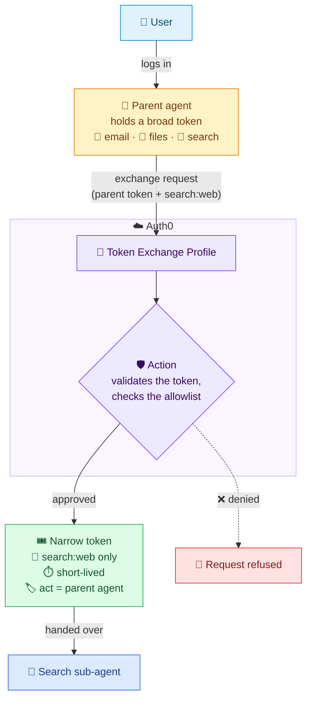

# Agent Token Exchange Demo 🔐 

Companion code for the article *"When One Agent Calls Another: Using Token Exchange to Limit What a Sub-Agent Inherits"*.

## The idea in one paragraph

Token exchange (OAuth 2.0, [RFC 8693](https://www.rfc-editor.org/rfc/rfc8693.html)) allows an app to send one token to the authorization server and get a different one back. The new token can have another audience, fewer scopes, or a shorter lifetime. Auth0 [**Custom Token Exchange (CTE)**](https://auth0.com/docs/authenticate/custom-token-exchange) allows you to add your own code to this step. A *Token Exchange Profile* maps a custom token type to an *Action*. The Action validates the incoming token, applies your rules, and approves or denies the exchange. This matters for agents, because a parent agent that delegates work usually forwards its own token. That gives the sub-agent every permission the parent has, nad that makes it risky.

## What this demo does

A **research agent** holds a broad token (email, files, search). It wants help from a **search sub-agent** that only needs to search. Instead of forwarding its own token, the parent exchanges it through Auth0. The Action checks the request against an allowlist and approves only what the sub-agent needs.



The Action only approves or denies. The issued scopes come from the request, and the token lifetime comes from the target API's settings.

## What `run_demo.py` checks

The script prints PASS or FAIL for 11 checks and exits with an error code if any fail.

| Step | Checks |
|------|--------|
| 1. Parent token | Audience is the Research Agent API, and all three scopes are present |
| 2. Exchange | The exchange succeeds. The new token has the Search Sub-Agent audience, only `search:web`, a shorter lifetime, an `act` claim naming the parent, and no refresh token |
| 3. Denials | Asking for `email:read`, asking for the wrong audience, and sending a tampered token are all refused |

## Project layout

```
agent-token-exchange-demo/
├── .env.example                          Settings template (copy to .env)
├── .gitignore
├── README.md
├── requirements.txt                      Python dependencies
├── config.py                             Loads and checks settings
├── auth0_client.py                       Login, token exchange, and claim decoding helpers
├── run_demo.py                           The demo
└── auth0_action/                         Action code for the Auth0 Dashboard (does not run locally)
   └── custom_token_exchange_action.js
```

## Auth0 setup checklist

You need an Auth0 tenant with Custom Token Exchange available. Check your plan, since the feature may be limited to certain plans or early access.

1. **Two APIs:** Turn on RBAC and "Add Permissions in the Access Token" for both.
   - Research Agent API (`https://research-agent.example.com`) with permissions `email:read`, `files:read`, `search:web`.
   - Search Sub-Agent API (`https://search-agent.example.com`) with permission `search:web`, a short token expiration (the demo run used 600 seconds), and "Allow Skipping User Consent" on.
2. **A test user and role:** The role holds all three Research Agent permissions and `search:web` from the Search Sub-Agent API.
3. **A "Parent Agent" application:** Create a first-party Regular Web Application.
   - Turn on Custom Token Exchange and enable the database connection.
   - Turn on the Password grant (demo only) and set the tenant's Default Directory.
   - Under API Access, authorize both APIs with their permissions (all three for the Research Agent API, `search:web` for the Search Sub-Agent API).
4. **A Token Exchange Profile.** Create it under Authentication > Custom Token Exchange, with a subject token type such as `https://research-agent.example.com/parent-token`.
5. **The Action under Custom Token Exchange:** Paste `auth0_action/custom_token_exchange_action.js`, add the dependencies and the `PARENT_CLIENT_ID` secret listed in its header, replace the placeholders, deploy, and attach it to the profile.

## Run it

```bash
python -m venv .venv
source .venv/bin/activate        # Windows: .venv\Scripts\activate
pip install -r requirements.txt
cp .env.example .env             # then fill in your values
python run_demo.py
```

A successful run prints this at the end:

```
RESULT: ALL 11 CHECKS PASSED
```

## Troubleshooting

- **"Client is not authorized to access resource server."** Authorize the app for that API under API Access.
- **HTTP 500 "server_error".** The Action code has an error. Re-check the pasted code and redeploy.
- **Any other exchange failure.** Open *Monitoring > Logs* in the Auth0 Dashboard and look for `fecte` entries.
- **Lifetime check fails.** Lower the token expiration on the Search Sub-Agent API.

## ⚠️ Demo-only shortcuts

- The Password grant stands in for a real user login. Do not use it in production.
- Delete the test user when you finish, and keep `.env` out of version control (The `.gitignore` file ensures this).

---